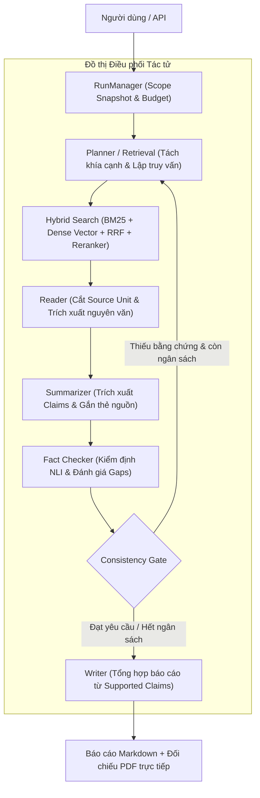

# Research Assist

> **Autonomous Multi-Agent Academic Research Engine & Verification System**

[](https://github.com/nguyentatmanh/Research-assist/actions)
[](https://www.python.org/)
[](https://fastapi.tiangolo.com/)
[](https://docs.astral.sh/ruff/)
[](LICENSE)

---

## Tổng quan

**Research Assist** là hệ thống nghiên cứu và tổng hợp tài liệu học thuật dựa trên kiến trúc 5 tác tử độc lập (*Retrieval, Reader, Summarizer, Fact Checker, Writer*). Hệ thống được thiết kế theo nguyên lý **Evidence-First**: mọi nhận định đưa vào báo cáo bắt buộc phải đối chiếu trực tiếp với vị trí ký tự (offset) và số trang PDF vật lý, loại bỏ hoàn toàn hiện tượng suy diễn không căn cứ (hallucination).

### Điểm khác biệt về mặt kỹ thuật:
- **Xác thực trích dẫn mức ký tự**: Không dừng lại ở việc gán ID tài liệu, hệ thống neo trích dẫn theo `Source Unit` (vị trí ký tự bắt đầu/kết thúc và trang thực tế của tệp PDF).
- **Bộ điều phối bằng mã (Deterministic Coordinator)**: Đồ thị nhiệm vụ DAG được quản lý bằng code nội bộ (`AutonomousCoordinator` / `ParallelResearchCoordinator`), không ủy quyền điều phối toàn quyền cho LLM để đảm bảo tính tất định và kiểm soát ngân sách token.
- **Tầng kiểm định NLI độc lập**: Fact Checker đánh giá mức độ entailment và phát hiện khoảng trống bằng chứng (evidence gaps) trước khi cấp quyền xuất bản cho Writer.

---

## Kiến trúc hệ thống

Luồng xử lý từ câu hỏi nghiên cứu đến báo cáo xuất bản:



### Các thành phần chính:

| Tác tử | Nhiệm vụ chính | Hợp đồng đầu ra (Contract) |
| :--- | :--- | :--- |
| **Planner / Retrieval** | Phân rã câu hỏi đa khía cạnh, chạy hybrid search qua SQLite FTS5 (BM25) và Dense Vector (BGE-M3). | `QuestionPlan`, `RetrievalPlan` |
| **Reader** | Quét các đoạn truy xuất, chuẩn hóa offset, trích dẫn nguyên văn không chỉnh sửa văn bản. | `SourceUnit`, `Evidence` |
| **Summarizer** | Tổng hợp các nhận định ngắn, độc lập, có thể kiểm chứng riêng lẻ. | `list[Claim]` |
| **Fact Checker** | Kiểm tra logic entailment giữa claim và source quote, xác định các khía cạnh chưa đủ bằng chứng. | `FactCheckOutput`, `EvidenceGap` |
| **Writer** | Chỉ tiếp nhận các claim có nhãn `supported`, xây dựng bố cục báo cáo và chỉ mục trích dẫn `[1]`, `[2]`. | `WrittenReport` |

---

## Cài đặt & Khởi chạy

### Yêu cầu tiên quyết
- Python `>= 3.11`
- Node.js `>= 20` (nếu chạy test UI / Playwright)

### 1. Cài đặt môi trường

```bash
git clone https://github.com/nguyentatmanh/Research-assist.git
cd Research-assist

python -m venv .venv

# Kích hoạt venv (Windows PowerShell)
.venv\Scripts\Activate.ps1
# Kích hoạt venv (Linux / macOS)
source .venv/bin/activate

pip install -e ".[dev]"
```

### 2. Cấu hình biến môi trường

Sao chép tệp mẫu:
```bash
cp .env.example .env
```

Hệ thống mặc định sử dụng `RA_LLM_PROVIDER=demo` (chế độ trích xuất offline, không cần API key). Để kết nối các dịch vụ AI khác, cập nhật `.env`:

```ini
# Chế độ điều phối
RA_ORCHESTRATION_MODE=autonomous
RA_WORKFLOW_PROFILE=balanced

# Cấu hình Model (Tùy chọn: gemini | openai | deepseek | ollama | demo)
RA_LLM_PROVIDER=gemini
RA_LLM_MODEL=gemini-2.0-flash
RA_GEMINI_API_KEY=your_api_key_here

# Cấu hình Vector & Reranker (Tùy chọn)
RA_EMBEDDING_PROVIDER=none
RA_RERANKER_PROVIDER=none
```

### 3. Khởi động Web Server

```bash
python -m research_assist.cli serve --host 127.0.0.1 --port 8000
```

Truy cập:
- **ResearchDesk Studio**: `http://127.0.0.1:8000/desk`
- **Swagger API Docs**: `http://127.0.0.1:8000/docs`

---

## Giao diện ResearchDesk Studio

Giao diện web (`/desk`) cung cấp không gian làm việc tích hợp cho nghiên cứu học thuật:

1. **Thư viện tài liệu & Literature Scout**: Quản lý tệp PDF tải lên và tích hợp tìm kiếm bài báo trực tuyến từ **OpenAlex** API.
2. **Theo dõi tiến trình Agent (Live Trace)**: Giám sát trạng thái từng task, độ trễ, số lượt gọi model và mức tiêu thụ token thời gian thực.
3. **Đọc PDF tương tác**: Nhấp vào bất kỳ mã trích dẫn `[N]` trong báo cáo để mở trình xem PDF, tự động cuộn đến trang và bôi sáng đoạn trích dẫn tương ứng.
4. **Xuất bản dữ liệu**: Hỗ trợ tải báo cáo Markdown, xuất bảng so sánh ra CSV và kết xuất PDF báo cáo.

---

## Giao diện dòng lệnh (CLI)

Hệ thống hỗ trợ các tác vụ quản trị thông qua CLI:

```bash
# Khởi động dịch vụ web
python -m research_assist.cli serve

# Nạp dữ liệu tài liệu mẫu để kiểm thử
python -m research_assist.cli seed

# Thực hiện truy vấn nghiên cứu trực tiếp từ terminal
python -m research_assist.cli ask "So sánh cơ chế attention trong Transformer và RNN."

# Cập nhật lại chỉ mục vector
python -m research_assist.cli reindex

# Tái tạo toàn bộ cơ sở dữ liệu chunk từ tệp gốc
python -m research_assist.cli rebuild
```

---

## Phòng huấn luyện mô hình (Training Lab)

Thư mục [`training_lab/`](training_lab/) chứa mã nguồn, dữ liệu và các notebook tinh chỉnh (fine-tuning) cho từng tác tử chuyên biệt:

| Notebook | Môi trường mục tiêu | Mô hình cơ sở | Kỹ thuật |
| :--- | :---: | :--- | :--- |
| [`colab_agent1-agent2-agent4.ipynb`](training_lab/finish-lab/colab_agent1-agent2-agent4.ipynb) | Google Colab (T4) | Qwen2.5-7B, LayoutLMv3, BGE-Reranker-v2-m3 | QLoRA ($r=64$), Focal Loss, NLI Classification Head |
| [`colab_agent3.ipynb`](training_lab/finish-lab/colab_agent3.ipynb) | Google Colab (T4) | Qwen2.5-7B-Instruct | Dual-QLoRA: SFT + DPO phạt hallucination |
| [`kaggle_agent5.ipynb`](training_lab/finish-lab/kaggle_agent5.ipynb) | Kaggle (P100 / T4) | Qwen2.5-7B-Instruct | DoRA (Weight-Decomposed) + rsLoRA |
| [`kaggle_embedding-reranker.ipynb`](training_lab/finish-lab/kaggle_embedding-reranker.ipynb) | Kaggle (Dual T4) | BAAI/bge-m3, BAAI/bge-reranker-v2-m3 | LoRA với CachedMultipleNegativesRankingLoss |
| [`Train_Master_Dual_T4.ipynb`](training_lab/Train_Master_Dual_T4.ipynb) | Kaggle (Dual T4) | Toàn bộ 7 mô hình | Pipeline tự động hóa huấn luyện và đóng gói weights |

---

## Kiểm thử & Đảm bảo chất lượng

Dự án áp dụng quy chuẩn kiểm thử nhiều tầng (Unit, Integration, DOM, E2E):

```bash
# Kiểm tra chuẩn định dạng và linter
ruff check src tests scripts
ruff format --check src tests scripts

# Kiểm tra tĩnh kiểu dữ liệu
mypy src/research_assist

# Kiểm thử chức năng và độ bao phủ mã (Coverage)
pytest --cov=research_assist --cov-report=term-missing

# Kiểm thử tương tác DOM (JSDOM)
npm run test:dom

# Kiểm thử đầu cuối trình duyệt (Playwright)
npm run test:ui
npm run test:ui:workflow
npm run test:ui:papers
```

---

## Cấu trúc thư mục

```text
research-assist/
├── src/research_assist/
│   ├── agents/            # Triển khai 5 tác tử, prompt templates và verification policies
│   ├── api/               # FastAPI routing, streaming response, export endpoints
│   ├── application/       # Tầng ứng dụng: coordinator, pipeline, runs runner, scout
│   ├── domain/            # Domain models, protocols, source unit contracts
│   ├── infrastructure/    # Kết nối cơ sở dữ liệu SQLite FTS5, LLM providers, search
│   └── web/               # Frontend ResearchDesk Studio (HTML, CSS, Vanilla JS)
├── training_lab/          # Dataset và notebook huấn luyện LoRA/DoRA
├── sample_papers/         # Dữ liệu tài liệu nghiên cứu mẫu
├── tests/                 # Toàn bộ test suite (Python + Node.js Playwright)
├── pyproject.toml         # Cấu hình gói và dependencies
└── README.md
```

---

## Giấy phép

Mã nguồn được phân phối theo giấy phép [MIT](LICENSE).
